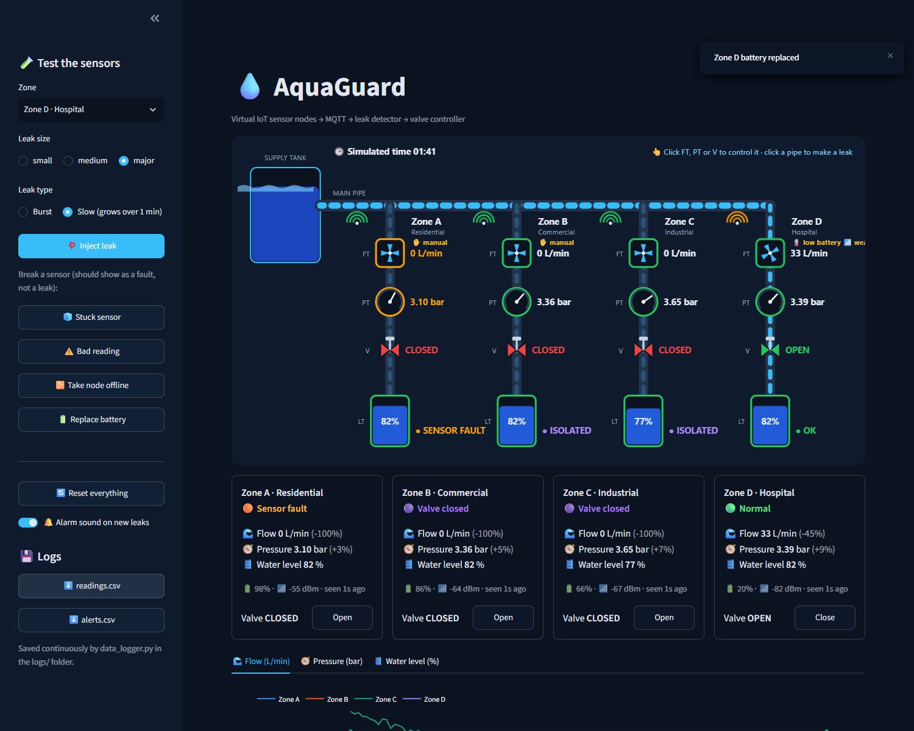

# 💧 AquaGuard: IoT Water Leak Detection

A simple virtual IoT project. Sensor nodes measure **flow, pressure and water level** in four zones. They send readings over **MQTT**, a detector spots leaks, broken sensors and low batteries, and a valve closes automatically when there's a leak.



```
Sensor nodes ──MQTT──▶ Leak detector ──alert──▶ Valve controller
     │                      │
     └────────▶ Dashboard ◀─┴────▶ CSV logs
```

## Files

| File | What it does |
|---|---|
| `sensor_nodes.py` | 4 virtual IoT nodes (one per zone): flow, pressure and water-level sensors, plus battery and Wi-Fi signal. |
| `detector.py` | Checks every reading and raises leak, sensor-fault and low-battery alerts. |
| `valves.py` | Virtual valves. They close automatically on a leak, and you can also open or close them by hand. |
| `data_logger.py` | Saves every reading and alert to `logs/readings.csv` and `logs/alerts.csv`. |
| `dashboard.py` + `schematic.py` | One-page live dashboard with an animated pipe and sensor drawing. |
| `esp32/aquaguard_node.ino` | Code for a **real** ESP32 sensor node (see below). |
| `config.yaml` | Zones, MQTT login, detection thresholds. |
| `run_all.py` | Starts everything with one command. |

## What makes it realistic

- **Daily water use:** demand is low at night and peaks in the morning and evening. One simulated day lasts 10 minutes, and the clock is shown on the drawing.
- **Pipe physics:** more flow means a little less pressure, because of friction.
- **Batteries:** they drain, and a flat battery takes the node offline. Zone D starts low, so you'll see the warning.
- **Weak Wi-Fi:** some readings are lost. Zone D has a weak signal, and the dashboard counts the lost readings.

## How detection works

- **Normal is learned** from the data, so it follows the daily pattern and any settings you change.
- **Leak:** both signals together, for **3 readings in a row**:
  - flow is **10 %** above normal, *and*
  - pressure is **8 %** below what that flow should give.

  Extra demand raises flow, but pressure follows the normal curve, so it isn't flagged. A leak adds flow **and** loses extra pressure.

  Severity depends on the extra flow: small (10–20 %), medium (20–40 %) or major (over 40 %).
- **Sensor fault:** a sensor is stuck, not responding, or sends an impossible value. A fault is never reported as a leak.
- **Low battery:** below 20 %. **Offline node:** no reading for 5 s, or its MQTT last will fires.

## MQTT topics

| Topic | Message |
|---|---|
| `aquaguard/sensors/{zone}` | `{"seq": 42, "flow": 99.8, "pressure": 3.01, "level": 80.2, "battery": 99.5, "rssi": -61}` |
| `aquaguard/sensors/{zone}/status` | `{"online": true}` (retained, last will) |
| `aquaguard/alerts` | `{"zone": "D", "type": "leak", "severity": "major", "status": "active"}` |
| `aquaguard/valves/{zone}` | `{"state": "CLOSED"}` (retained) |
| `aquaguard/valves/{zone}/set` | `{"action": "close"}` |
| `aquaguard/test` | test actions from the dashboard |

**Security:** the broker needs a **username and password**, set in `config.yaml`. Connections without them are refused.

## Run it

```bash
pip install -r requirements.txt
python run_all.py
```

The dashboard opens at http://localhost:8501.

The built-in Python broker starts with password login automatically. To use **Mosquitto** instead:
1. Create the user: `mosquitto_passwd -c passwd aquaguard`
2. Run Mosquitto with `allow_anonymous false` and `password_file passwd`.
3. Start it before `run_all.py`.

## Try it

**Click the pipe drawing:**

| Click | Options |
|---|---|
| **a pipe** | create a leak there, burst or slow (it grows over 1 minute) |
| **FT** (flow sensor) | water demand (0–200 %); sensor Working / Stuck / Off |
| **PT** (pressure sensor) | supply pressure (1–5 bar); sensor Working / Stuck / Bad reading / Off |
| **V** (valve) | Open / Close |

A zone you've changed shows a **✋ manual** tag. A beep sounds on every new leak, and the sidebar switch turns it off.

**Sidebar:** inject a leak, break a sensor, take a node offline, replace a battery, reset everything, download the CSV logs.

## Real hardware (ESP32)

`esp32/aquaguard_node.ino` turns an ESP32 into a real node for one zone. It uses:
- a YF-S201 flow sensor on GPIO 27
- a 0.5–4.5 V pressure transducer on GPIO 34, through a voltage divider
- optionally, an HC-SR04 ultrasonic sensor for the tank level

It publishes the same MQTT message as the virtual nodes, so nothing else needs changing. Set your Wi-Fi details, the broker's IP address and the login at the top of the file. The broker must listen on your network, so use Mosquitto rather than the built-in broker (which only listens on this PC). Then stop that zone's virtual node.

## Tests

```bash
python -m pytest
```

The tests cover the leak rule, including a **full simulated day with no false alarms** and a **slow leak caught within a minute**, as well as the sensor-fault checks.
